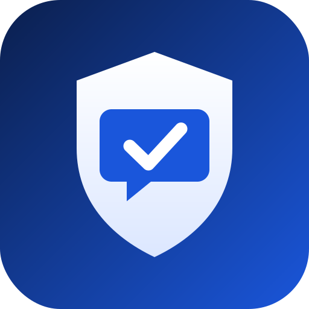
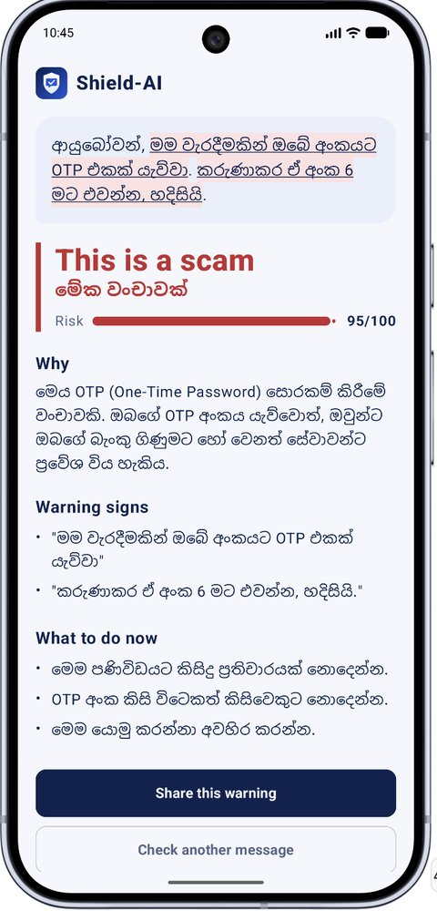
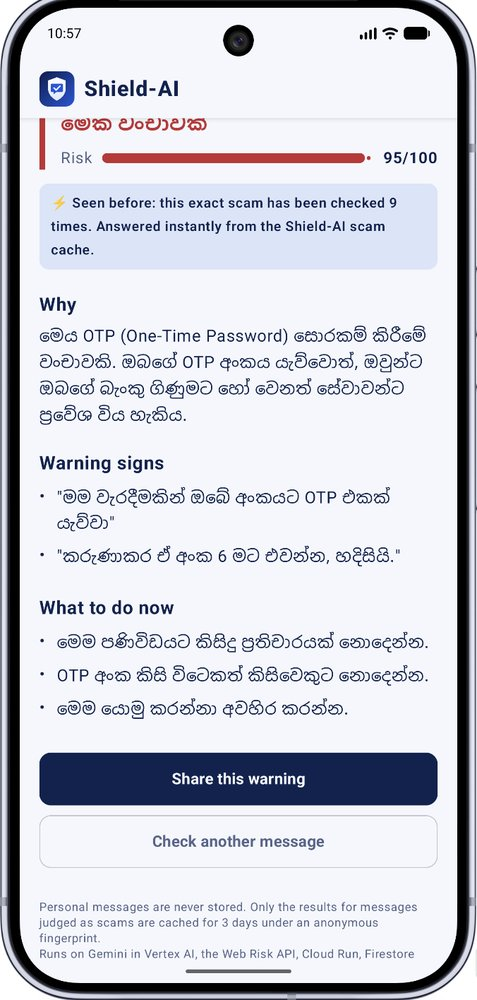
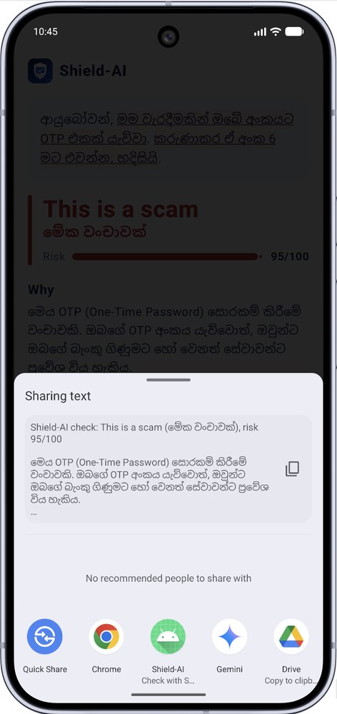
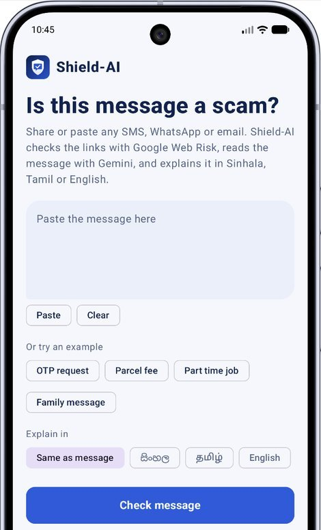
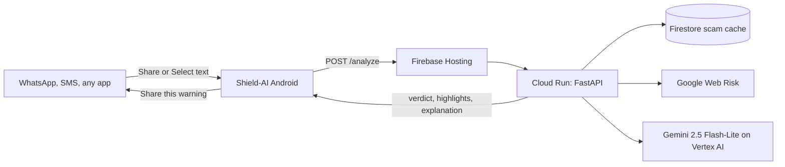

<p align="center">
  
</p>

<h1 align="center">Shield-AI for Android</h1>

<p align="center">
  Check a suspicious SMS or WhatsApp message without leaving the chat.<br>
  Share it to Shield-AI, or select the text in any app, and get the answer in Sinhala, Tamil or English.
</p>

<p align="center">
  <a href="https://shield-ai-2026.web.app"><b>Live web app</b></a>
  &nbsp;·&nbsp;
  <a href="https://github.com/amalskr/shield-ai"><b>Backend and web repo</b></a>
</p>

Built for the **Google Cloud AI Builder Cup 2026** (BFSI: Intelligent Risk, Fraud & Financial Experiences) by team Shield-AI.

<p align="center">
  
  
  
  
</p>

## Why an Android app

Scams arrive inside WhatsApp and SMS. Copying a message into a website is one step too many for the people most likely to be caught, such as elderly parents. On Android, Shield-AI sits where the scam is:

* **Share sheet:** long press a message in WhatsApp, Messages or Gmail, tap **Share**, choose **Shield-AI**. The app opens and checks it straight away.
* **Text selection menu:** select text in any app and tap **Check with Shield-AI**. This works even in apps that have no share button.
* **Share the warning back:** one tap sends the verdict and explanation to a family WhatsApp group.

## What you get

* A verdict (**Safe**, **Be careful**, **This is a scam**) with a 0 to 100 risk score
* The **exact suspicious words highlighted** inside the original message
* The verdict repeated in **Sinhala or Tamil script** when the message is in that language, including Singlish and Tanglish
* Why it is a scam and **what to do now**, in the language of the message
* Every link checked by **Google Web Risk**, with a clear "Flagged by Google Web Risk" label
* An **instant answer** when the same scam was already checked by someone else (Firestore scam cache), with how many times it has been seen
* Light and dark themes that match the web app

## How it works

The app is a thin, fast client. All analysis runs on the Shield-AI backend on Google Cloud:



See the [backend repository](https://github.com/amalskr/shield-ai) for the API, prompt, language routing, caching and privacy design.

## Code structure

```
app/src/main/java/com/ceylonapz/shield_ai/
  MainActivity.kt      Entry point. Handles ACTION_SEND (share sheet) and ACTION_PROCESS_TEXT (text selection)
  ShieldViewModel.kt   UI state: Editing, Checking, Done, Failed
  ShieldApi.kt         Calls POST /analyze and parses the JSON response
  ShieldScreen.kt      Jetpack Compose UI: input, result, highlights, cache badge, share
  ShieldTheme.kt       Colors shared with the web app, light and dark
```

Design choices:

* **No extra dependencies.** Networking uses `HttpURLConnection` and `org.json` from the Android SDK, so the app builds on a fresh Android Studio template with no Gradle changes.
* **One source of truth.** The highlight logic is the same algorithm as the web app, so both clients mark the same words.
* **singleTop activity.** Sharing a new message while the app is open replaces the old result instead of stacking screens.

## Build and run

Requirements: Android Studio (latest stable), JDK 17, a device or emulator with internet access.

```bash
git clone https://github.com/amalskr/Shield-AI-Android.git
```

1. Open the project in Android Studio and let Gradle sync.
2. Run the `app` configuration on a device or emulator.
3. Tap an example such as **OTP request**, then **Check message**.

To try the share flow, open WhatsApp or Messages, long press a message, tap **Share** and choose **Shield-AI**.

The backend URL is set in `ShieldApi.kt`:

```kotlin
const val BASE_URL = "https://shield-ai-2026.web.app"
```

## API contract

`POST /analyze`

```json
{ "text": "the message", "reply_language": "auto" }
```

`reply_language` is `auto`, `si`, `ta` or `en`. The app reads `verdict`, `risk_score`, `red_flags`, `explanation`, `recommended_actions`, `url_checks`, `cached` and `seen_count`.

## Privacy

The app stores nothing on the device. Messages are sent over HTTPS to the Shield-AI backend for analysis. Personal messages are never stored there either: only the results for messages judged as scams are cached for 3 days under an anonymous SHA-256 fingerprint.

## Tech

Kotlin, Jetpack Compose, Material 3, AndroidX Lifecycle ViewModel, Android share and text processing intents.

## Team

Team Shield-AI: [Amal Ranasinghe](https://github.com/amalskr)
